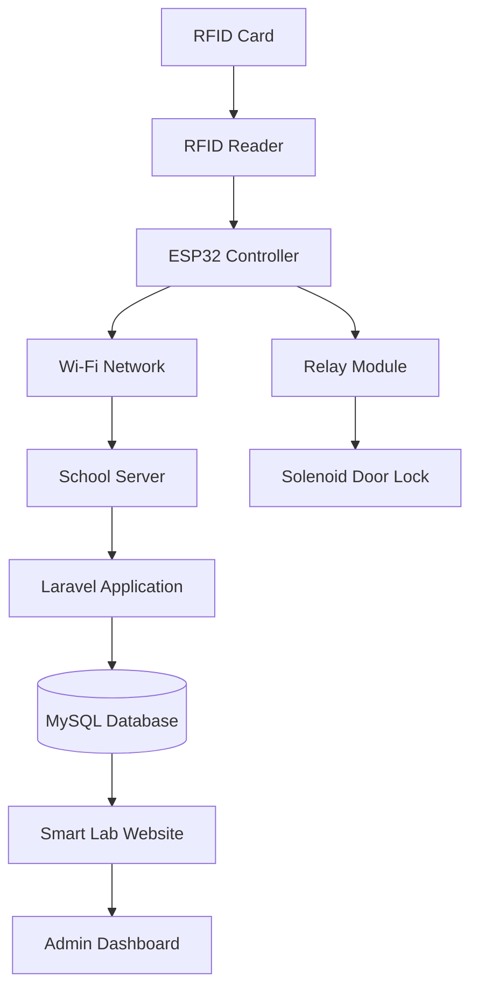

<div align="center">

# SMART LAB

### RFID-Based Laboratory Key Management System

**Sistem Peminjaman dan Pengelolaan Kunci Laboratorium Berbasis RFID dan Website**

<p>
  
  
  
</p>

<p>
  
  
  
  
</p>

---

Smart Lab merupakan sistem peminjaman dan pengelolaan kunci laboratorium yang mengintegrasikan teknologi RFID, ESP32, solenoid door lock, dan website untuk mempermudah proses peminjaman, pengembalian, serta monitoring penggunaan laboratorium.

**Developed at SMKN 6 Malang**

</div>

---

## About The Project

Pengelolaan peminjaman kunci laboratorium secara manual memiliki beberapa kendala, seperti pencatatan yang tidak konsisten, kesulitan mengetahui pihak yang sedang memegang kunci, keterlambatan pengembalian, serta kurangnya informasi mengenai ketersediaan laboratorium.

Smart Lab dikembangkan sebagai solusi berbasis Internet of Things (IoT) untuk mendigitalisasi proses peminjaman dan pengembalian kunci laboratorium.

Melalui penggunaan kartu RFID, pengguna dapat melakukan autentikasi secara langsung pada loker yang telah dilengkapi sistem pengunci elektronik. Seluruh aktivitas peminjaman dan pengembalian dicatat dalam database dan dapat dipantau melalui website.

## Project Objectives

- Digitalisasi proses peminjaman dan pengembalian kunci laboratorium.
- Mengidentifikasi pengguna menggunakan kartu RFID.
- Mengontrol akses loker menggunakan solenoid door lock.
- Memantau status penggunaan laboratorium melalui website.
- Menyimpan riwayat transaksi secara terstruktur.
- Mempermudah pengawasan oleh pengurus laboratorium.

---

## Main Features

<table>
  <tr>
    <td width="50%">
      <h3>RFID Authentication</h3>
      Identifikasi siswa dan pengurus laboratorium menggunakan kartu RFID yang telah terdaftar.
    </td>
    <td width="50%">
      <h3>Electronic Locker</h3>
      Sistem penguncian dan pembukaan loker secara elektronik menggunakan solenoid door lock.
    </td>
  </tr>
  <tr>
    <td width="50%">
      <h3>Web Dashboard</h3>
      Menampilkan informasi ketersediaan laboratorium dan pengguna yang sedang meminjam kunci.
    </td>
    <td width="50%">
      <h3>Transaction History</h3>
      Menyimpan dan menampilkan riwayat peminjaman serta pengembalian kunci.
    </td>
  </tr>
  <tr>
    <td width="50%">
      <h3>Admin Management</h3>
      Pengurus dapat mengelola data pengguna, laboratorium, dan transaksi.
    </td>
    <td width="50%">
      <h3>Device Notification</h3>
      Menggunakan LCD, buzzer, dan LED sebagai indikator proses pada perangkat.
    </td>
  </tr>
</table>

---

## System Workflow

### Borrowing Process

1. Siswa mendatangi loker laboratorium yang ingin digunakan.
2. Siswa menempelkan kartu RFID yang telah terdaftar pada RFID reader.
3. ESP32 membaca UID kartu RFID.
4. ESP32 mengirimkan data ke server melalui jaringan Wi-Fi.
5. Server memvalidasi identitas pengguna dan status loker.
6. Jika transaksi diizinkan, sistem mengaktifkan solenoid untuk membuka pengunci.
7. Siswa membuka loker dan mengambil kunci laboratorium.
8. Sistem menyimpan transaksi peminjaman dan memperbarui status pada website.

### Returning Process

1. Pengguna kembali ke loker tempat kunci dipinjam.
2. Pengguna melakukan pemindaian kartu RFID yang sama.
3. Server memeriksa transaksi peminjaman yang masih aktif.
4. Jika pengembalian valid, solenoid membuka pengunci.
5. Pengguna memasukkan kembali kunci dan menutup loker.
6. Sistem mencatat waktu pengembalian.
7. Status loker diperbarui pada website.

> **Note:** Solenoid berfungsi sebagai pengunci elektrik. Pintu loker tetap dibuka dan ditutup secara manual oleh pengguna.

---

## System Architecture

Berikut merupakan gambaran arsitektur komunikasi antara perangkat keras, server, database, dan website Smart Lab.



### Architecture Explanation

| Layer | Component | Description |
|---|---|---|
| Input | RFID Card | Identitas pengguna |
| Reader | MFRC522 | Membaca UID kartu |
| Controller | ESP32 | Memproses data perangkat |
| Network | Wi-Fi | Komunikasi dengan server |
| Backend | Laravel | Validasi dan pengelolaan data |
| Database | MySQL | Penyimpanan data transaksi |
| Interface | Website | Monitoring dan administrasi |
| Output | Relay and Solenoid | Kontrol pengunci loker |

---

## Hardware Components

Komponen perangkat keras yang digunakan dalam pengembangan prototype Smart Lab.

| No. | Component | Function |
|:---:|---|---|
| 1 | ESP32 | Mikrokontroler utama |
| 2 | RFID MFRC522 | Membaca kartu RFID |
| 3 | RFID Card | Identitas pengguna |
| 4 | Solenoid Door Lock 12V | Pengunci elektrik |
| 5 | Relay Module | Mengontrol solenoid |
| 6 | LCD 16x2 I2C | Menampilkan informasi perangkat |
| 7 | Buzzer | Memberikan notifikasi suara |
| 8 | LED Indicator | Menampilkan indikator status |
| 9 | Power Supply | Menyediakan sumber daya |
| 10 | Microswitch | Mendeteksi posisi mekanis sesuai rancangan |

### Prototype Specification

| Specification | Description |
|---|---|
| Project Name | Smart Lab |
| Number of Lockers | 2 Units |
| Laboratory | LAB TKJ 1 and LAB TKJ 2 |
| Student Users | 9 Students |
| Laboratory Admins | 3 Admins |
| Access Method | RFID Card |
| Lock Mechanism | Electric Solenoid |
| Server | School Server |
| Platform | IoT and Web Application |

---

## Technology Stack

Teknologi yang digunakan dalam pengembangan sistem Smart Lab.

| Technology | Usage |
|---|---|
| ESP32 | Microcontroller |
| MicroPython | Firmware Programming |
| Thonny IDE | ESP32 Development |
| PHP | Server-side Processing |
| Laravel | Web Application Framework |
| MySQL | Database Management |
| HTML | Web Structure |
| CSS | Web Styling |
| JavaScript | Frontend Interaction |
| REST API | Device and Server Communication |
| Wi-Fi | Network Communication |

---

## User Roles

Smart Lab memiliki dua jenis pengguna dengan hak akses yang berbeda.

### 1. Student

- Melakukan peminjaman kunci menggunakan kartu RFID.
- Melakukan pengembalian kunci menggunakan kartu RFID yang sama.
- Melihat informasi ketersediaan laboratorium melalui website.

### 2. Laboratory Admin

- Login ke halaman administrasi.
- Memantau status peminjaman dan pengembalian.
- Melihat identitas pengguna yang sedang meminjam.
- Mengelola data pengguna.
- Mengelola data laboratorium dan loker.
- Melihat riwayat transaksi.
- Melakukan pengawasan terhadap aktivitas penggunaan laboratorium.

---

## Database Overview

Secara konseptual, database Smart Lab mengelola beberapa kelompok data berikut.

| Data | Description |
|---|---|
| Users | Menyimpan informasi pengguna dan UID RFID |
| Laboratories | Menyimpan data laboratorium |
| Lockers | Menyimpan data dan status setiap loker |
| Transactions | Menyimpan aktivitas peminjaman dan pengembalian |
| Admins | Menyimpan akun administrator |

Struktur tabel dan relasi database dapat disesuaikan dengan implementasi aplikasi.

---

## Project Structure

Gambaran umum pemisahan komponen proyek:

```text
smart-lab/
|
|-- firmware/
|   |-- main.py
|   |-- rfid.py
|   |-- wifi.py
|   |-- api.py
|   |-- locker.py
|   |-- display.py
|   |
|   `-- README.md
|
|-- website/
|   |-- app/
|   |-- bootstrap/
|   |-- config/
|   |-- database/
|   |-- public/
|   |-- resources/
|   |-- routes/
|   |-- storage/
|   |-- tests/
|   `-- README.md
|
|-- documentation/
|   |-- architecture/
|   |-- diagrams/
|   |-- hardware/
|   `-- images/
|
`-- README.md
```

> Struktur di atas merupakan contoh pengorganisasian proyek. Nama folder dan file dapat disesuaikan dengan struktur implementasi sebenarnya.

---

## Security and Emergency Handling

Beberapa aspek keamanan yang diperhatikan dalam pengembangan Smart Lab:

- Hanya kartu RFID terdaftar yang dapat melakukan transaksi.
- Sistem memeriksa transaksi aktif untuk mencegah peminjaman ganda pada loker yang sama.
- Halaman administrasi dilindungi autentikasi.
- Komponen solenoid menggunakan sumber daya sesuai spesifikasinya.
- Pengurus laboratorium memiliki prosedur pembukaan manual ketika terjadi gangguan listrik atau kerusakan sistem.
- Mekanisme pembukaan darurat hanya digunakan oleh petugas yang berwenang.

---

## Future Development

Rencana pengembangan Smart Lab selanjutnya meliputi:

- Pengembangan prototype menjadi sistem dengan lebih banyak loker.
- Penambahan notifikasi keterlambatan pengembalian.
- Pengembangan fitur laporan dan ekspor riwayat transaksi.
- Peningkatan keamanan komunikasi perangkat dengan server.
- Penyempurnaan sistem monitoring kondisi pintu loker.
- Pengujian kestabilan perangkat keras dan perangkat lunak.

---

## Project Information

<div align="center">

| Information | Details |
|---|---|
| Project Name | Smart Lab |
| Project Category | Internet of Things |
| Project Type | Hardware and Web Application |
| Development Environment | SMKN 6 Malang |
| Program | Sistem Informasi, Jaringan, dan Aplikasi |
| Academic Year | 2026/2027 |
| Prototype | 2 Laboratory Lockers |

---

**SMART LAB**

*Smart Technology for Better Laboratory Management.*

SMKN 6 Malang

</div>
